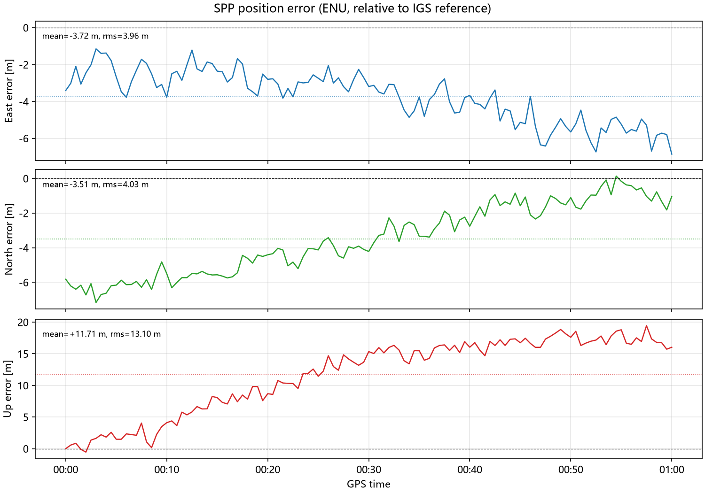
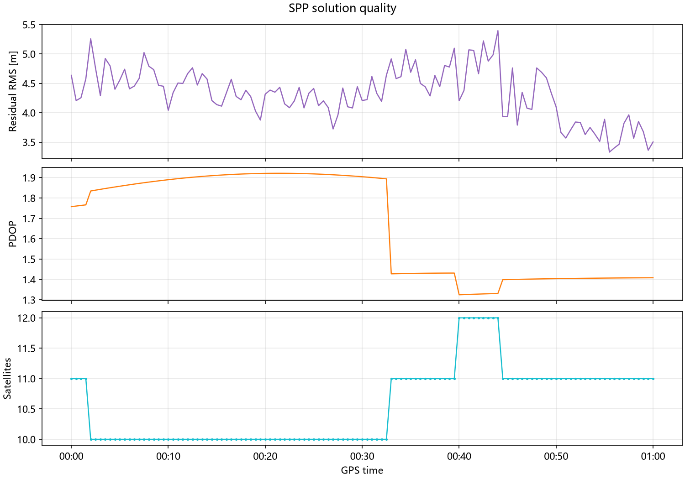
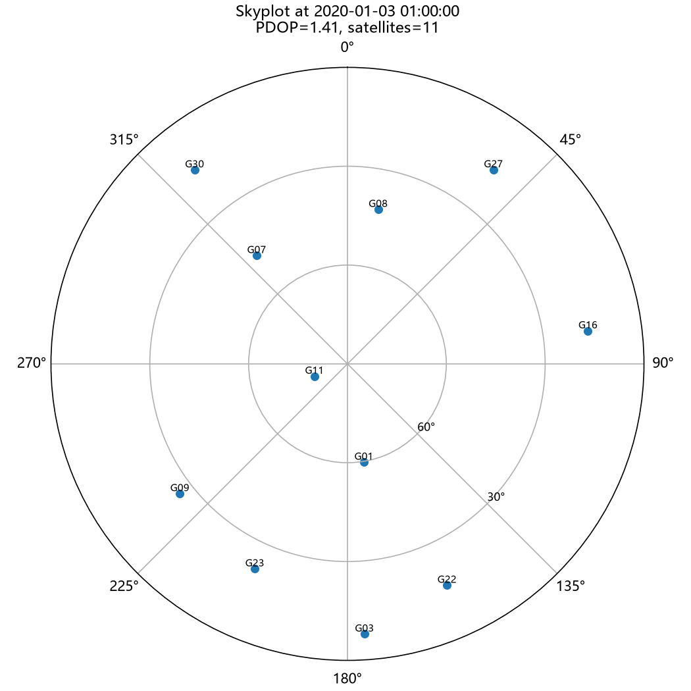

# 伪距单点定位（SPP）

[](https://github.com/zbf1154-ctrl/PseudoRangePointPositioning/actions/workflows/ci.yml)
[](https://www.python.org/)
[](LICENSE)

基于 Python 的 GNSS 伪距单点定位工具。程序读取 RINEX 2.x 观测文件、RINEX 3.0
钟差文件和 SP3 精密轨道，完成时间对齐、卫星位置插值、对流层/电离层改正、
逐历元抗差最小二乘解算、精度统计、CSV/JSON 导出与可视化。

项目附带一组 **ABMF 测站 2020-01-03 00:00–01:00（GPS 时）** 的示例数据：
30 s 采样观测、IGS 30 s 钟差和 15 min SP3 精密轨道。默认流程可在约 2 秒内
完成 121 个历元的解算。

---

## 1. 功能特性

- **格式解析**
  - RINEX 2.11 观测文件（固定 16 列字段、跨行卫星列表、事件记录、`D` 指数）；
  - RINEX 3.0 钟差文件（`AS` 卫星钟差、`AR` 测站钟差、`SOLN STA` 坐标）；
  - SP3-a/b/c/d 精密轨道（km → m，缺失值处理，坐标系识别）。
- **时间对齐**
  - 重心形式拉格朗日插值（默认 9 阶），把 15 min SP3 轨道插值到 30 s 观测时刻；
  - 钟差线性插值，并允许信号发射时刻相对首个历元的轻微外推。
- **观测模型**
  - 伪距方程 `P = ρ + c·δt_r − c·δt_s + I + T`；
  - 信号传播时间迭代、地球自转（Sagnac）改正；
  - Saastamoinen 对流层模型 + 高度角映射；
  - Klobuchar 电离层模型（观测头有 α/β 时可用）；
  - 单频 `C1/P1` 或双频 `P1/P2` 无电离层组合，`auto` 模式自动选择。
- **参数估计**
  - Gauss-Newton 迭代、高度角定权、PDOP 检核；
  - Huber 型标准化残差剔除（可关闭），支持最少卫星数/截止高度角配置。
- **结果与可视化**
  - 逐历元 CSV（ECEF、经纬高、ENU 误差、钟差、残差、PDOP、卫星数、模式）；
  - JSON 摘要（配置、数据源、统计量、失败历元）；
  - ENU 误差图、解算质量图、天空图。
- **两种入口**
  - 命令行：`python -m spp run`；
  - 图形界面：`python main.py`（Tkinter，后台线程解算，实时日志/进度）。

---

## 2. 快速开始

### 2.1 环境

- Python **3.9+**（Windows / Linux / macOS）
- 依赖：`numpy`、`matplotlib`；测试额外需要 `pytest`
- GUI 需要 Tkinter（Windows 官方 Python 自带；Ubuntu 可安装 `python3-tk`）

```bash
git clone https://github.com/zbf1154-ctrl/PseudoRangePointPositioning.git
cd PseudoRangePointPositioning
python -m venv .venv
# Windows
.venv\Scripts\activate
# Linux / macOS
source .venv/bin/activate

pip install -r requirements.txt
```

### 2.2 运行完整流程

```bash
python -m spp run
```

默认读取 `data/` 下的三个文件，处理 2020-01-03 00:00–01:00，结果写入 `outputs/`：

```text
outputs/spp_solutions.csv     逐历元解算结果
outputs/spp_summary.json      配置与精度统计
outputs/spp_failures.csv      失败历元（无失败时不生成）
outputs/spp_enu_error.png     ENU 误差时间序列
outputs/spp_quality.png       残差 / PDOP / 卫星数
outputs/spp_skyplot.png       最后一个历元的天空图
```

常用参数：

```bash
# 只处理前 10 分钟
python -m spp run --start "2020-01-03 00:00:00" --end "2020-01-03 00:10:00"

# 强制单频、关闭对流层、关闭抗差
python -m spp run --mode single --no-tropo --no-robust

# 指定文件与输出目录
python -m spp run \
  --sp3 data/igs20865.sp3 \
  --clk data/igs20865.clk_30s \
  --obs data/abmf0030.20o \
  --out outputs/demo --prefix abmf
```

查看全部参数：

```bash
python -m spp run --help
python -m spp info
```

### 2.3 图形界面

```bash
python main.py
```

界面支持：

- 选择 SP3 / CLK / OBS 文件；
- 设置时间窗、测站、频率模式、截止高度角、最少卫星数、PDOP 上限；
- 开关对流层、电离层与抗差估计；
- 后台线程解算，实时日志与进度条；
- 统计摘要、ENU 误差图、质量图、天空图；
- 导出 CSV / JSON。

> 也可以直接运行 `python -m spp gui`。

---

## 3. 数据说明

| 文件 | 说明 | 大小 |
|------|------|------|
| `data/abmf0030.20o` | ABMF 测站 RINEX 2.11 观测，30 s 采样，26 种观测类型 | 约 19.8 MB |
| `data/igs20865.clk_30s` | IGS 组合钟差，30 s 采样，含 32 颗 GPS 卫星与测站钟差 | 约 12.4 MB |
| `data/igs20865.sp3` | IGS 精密轨道，15 min 采样，32 颗 GPS 卫星 | 约 0.2 MB |

默认时间窗：**2020-01-03 00:00:00 – 01:00:00（GPS 时）**；默认测站：**ABMF**。
测站参考坐标取自钟差文件头 `SOLN STA`，并与 RINEX 头 `APPROX POSITION` 交叉检查。

---

## 4. 工程结构

```text
PseudoRangePointPositioning/
├── main.py                  # GUI 启动器 / CLI 转发
├── pyproject.toml           # 打包、依赖、pytest 配置
├── requirements.txt
├── requirements-dev.txt
├── spp/
│   ├── __init__.py
│   ├── __main__.py          # python -m spp
│   ├── cli.py               # 命令行
│   ├── gui.py               # Tkinter 界面
│   ├── config.py            # 常量、路径、SolverConfig、TimeWindow
│   ├── models.py            # 观测/钟差/轨道/解算结果数据模型
│   ├── coords.py            # ECEF / 大地坐标 / ENU
│   ├── interpolate.py       # 拉格朗日轨道插值
│   ├── atmosphere.py        # Saastamoinen / Klobuchar
│   ├── rinex_obs.py         # RINEX 2.x 观测解析
│   ├── rinex_clk.py         # RINEX 3.0 钟差解析
│   ├── sp3.py               # SP3 轨道解析
│   ├── solver.py            # 逐历元抗差最小二乘
│   ├── pipeline.py          # 数据装载 + 流程编排 + 统计
│   ├── export.py            # CSV / JSON
│   └── plotting.py          # 图表
├── tests/                   # pytest 单元/集成测试
├── data/                    # 示例数据
├── docs/                    # 结果图与精度说明
└── outputs/                 # 运行产物（git 忽略）
```

---

## 5. 算法要点

### 5.1 观测方程与线性化

对卫星 `s`：

```text
P_s = ρ_s + c·δt_r − c·δt_s + T_s + I_s + ε_s
```

其中 `ρ_s = ||r_s(t_tx) − r_r(t_rx)||`，`t_tx = t_rx − τ`。程序迭代求解传播时间，
并对卫星位置施加地球自转改正：

```text
x' =  x·cos(ωτ) + y·sin(ωτ)
y' = −x·sin(ωτ) + y·cos(ωτ)
```

线性化后得到设计矩阵 `[−u_x, −u_y, −u_z, 1]`，未知数为接收机位置增量
`(dx, dy, dz)` 与接收机钟差等效距离 `c·δt_r`，用加权最小二乘求解。

### 5.2 定权与抗差

- 高度角定权：`σ = σ_0 + σ_1 / sin(el)`，默认 `σ_0 = 0.3 m`、`σ_1 = 0.9 m`；
- 双频无电离层组合噪声放大约 3 倍，权重相应降低；
- 抗差：按标准化残差 `|v| > k·σ` 剔除（默认 `k = 3`，最多 2 轮），
  且保证剔除后卫星数不少于 `min_satellites`。

### 5.3 大气改正

- 对流层：Saastamoinen 天顶延迟（标准大气、相对湿度 0.7）+ Niell 湿项映射；
- 电离层：Klobuchar 模型，仅在单频且观测头存在 `ION ALPHA` / `ION BETA` 时启用；
- 双频模式使用 `P1/P2` 无电离层组合，默认不再叠加电离层模型。

### 5.4 质量检核

- 截止高度角（默认 5°）；
- 最少卫星数（默认 4）；
- PDOP 上限（默认 30）；
- 非有限值、奇异法方程、迭代不收敛均记录为失败历元并继续处理后续历元。

---

## 6. 示例结果

配置：`auto` 模式（示例数据全部历元选中双频 `P1/P2` 无电离层组合）、
对流层开、抗差开、截止高度角 5°、`min_satellites=4`。

| 指标 | 数值 |
|------|------|
| 有效 / 总历元 | **121 / 121** |
| 失败历元 | 0 |
| 3D 误差均值 | **13.59 m** |
| 3D 误差中位数 | **15.15 m** |
| 3D 误差 P95 | **18.99 m** |
| 3D 误差最大 | **20.18 m** |
| ENU 均值 (E/N/U) | **−3.72 / −3.51 / +11.71 m** |
| ENU RMS (E/N/U) | **3.96 / 4.03 / 13.10 m** |
| 观测残差 RMS 均值 | **4.33 m** |
| 平均 PDOP | **1.67** |
| 平均卫星数 | **10.6** |
| 耗时 | **约 1.9 s** |







> 说明：本程序使用**纯伪距**，未做载波平滑、卫星/接收机天线相位中心（PCO/PCV）、
> 差分码偏差（DCB）、固体潮/海潮等改正。示例数据中可观察到明显的
> **逐卫星系统性距离偏差**，因此绝对定位精度约十几米；这属于数据/模型层面的
> 一致性限制，而不是解算流程失败。详细参数对照见 [docs/results.md](docs/results.md)。

---

## 7. 测试与持续集成

```bash
pip install -r requirements-dev.txt
python -m pytest -q
```

测试覆盖：

- 配置校验与时间窗；
- ECEF / 大地坐标 / ENU 往返；
- 对流层、电离层模型的量级与边界；
- 拉格朗日插值（二次多项式精确复现、节点、越界）；
- RINEX 观测 / 钟差、SP3 解析的字段与数值；
- 首历元钟差边界、单频/双频解算、无对流层解算；
- CSV/JSON 导出、CLI 退出码与文件产物；
- GUI 模块可导入与窗口构造。

GitHub Actions 在 Python 3.9 与 3.12 上执行 `pytest`，并设置 `MPLBACKEND=Agg`
以适配无显示环境。

---

## 8. 许可与致谢

本项目采用 [MIT License](LICENSE)。

观测/钟差/轨道数据来自 IGS 公开产品，仅用于教学与算法演示；数据版权归数据
提供机构所有。参考坐标用于精度评估，不参与解算。
